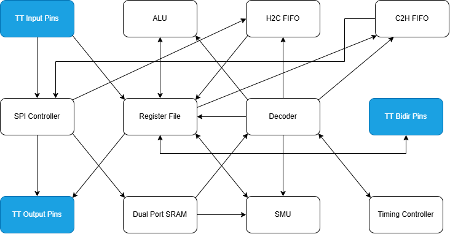

   

# 16-bit RISC Protocol Emulator

- [Read the documentation for project](docs/info.md)

This repository contains the SystemVerilog RTL, verification framework, and custom software toolchain for a 16-bit RISC I/O co-processor. The core is a single-cycle, Harvard architecture designed for deterministic, cycle-accurate multi-protocol emulation (SPI, I2C, USB 1.1, CAN, UART, Ethernet) and is targeted for the Tiny Tapeout IHP 130nm CMOS5L open-source silicon shuttle.

## System Architecture

## GDS Render

---

## Acknowledgments & Flow Credits

This project successfully incorporates hard SRAM macro integration and single-layer power domain extension building upon the open-source LibreLane plugin architecture from:
- **Flow & Integration Guide:** [Dropping a real SRAM macro into your CMOS5L tile](https://github.com/kdp1965/ihp-um-janestreet-prism)
- **Reference Repository:** [kdp1965/ihp-um-janestreet-prism](https://github.com/kdp1965/ihp-um-janestreet-prism)

---

## What is Tiny Tapeout?

Tiny Tapeout is an educational project that aims to make it easier and cheaper than ever to get your digital and analog designs manufactured on a real chip.

To learn more and get started, visit https://tinytapeout.com.

## Enable GitHub actions to build the results page

- [Enabling GitHub Pages](https://tinytapeout.com/faq/#my-github-action-is-failing-on-the-pages-part)

## Resources

- [FAQ](https://tinytapeout.com/faq/)
- [Digital design lessons](https://tinytapeout.com/digital_design/)
- [Learn how semiconductors work](https://tinytapeout.com/siliwiz/)
- [Join the community](https://tinytapeout.com/discord)
- [Build your design locally](https://www.tinytapeout.com/guides/local-hardening/)

## What next?

- [Submit your design to the next shuttle](https://app.tinytapeout.com/).
- Share your project on your social network of choice:
  - LinkedIn [#tinytapeout](https://www.linkedin.com/search/results/content/?keywords=%23tinytapeout) [@TinyTapeout](https://www.linkedin.com/company/100708654/)
  - Mastodon [#tinytapeout](https://chaos.social/tags/tinytapeout) [@matthewvenn](https://chaos.social/@matthewvenn)
  - X (formerly Twitter) [#tinytapeout](https://twitter.com/hashtag/tinytapeout) [@tinytapeout](https://twitter.com/tinytapeout)